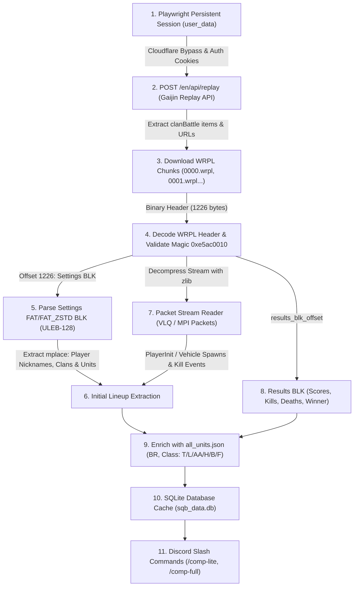

# 🦅 Anarchism Bot — War Thunder Squadron Discord Bot

[](https://www.python.org/)
[](https://nextcord.readthedocs.io/)
[](https://playwright.dev/)
[](https://www.gnu.org/licenses/agpl-3.0)

> **Language Navigation / Navigation de langue**  
> 🇬🇧 **English** | 🇫🇷 [Version Française (README_FR.md)](README_FR.md)

---

## 📌 Project Overview

**Anarchism Bot** (`Test-Bot-WT`) is a specialized Discord bot developed for competitive **War Thunder Squadron Battles (SQB)** teams. Built on top of **Nextcord**, it combines full community management tools (recruitment, support tickets, temporary voice rooms, welcome cards) with competitive intel:

- **Real-time SQB Lineup & Composition Intel**: inspect opposing squadron compositions (`/comp-lite`, `/comp-full`, `/log-squadron`).
- **Gaijin Tournament Server Replay Sniffer**: tracks clan battles directly from Gaijin's official tournament replay servers.
- **Binary WRPL Parser**: reverse-engineers and decodes `.wrpl` replays (FAT BLK, zlib-compressed packet streams, player init, kills, and end-game scoreboards).
- **Squadron Battle Rotation Web Scraper**: automatically monitors Battle Rating (BR) rotations from the War Thunder forums.
- **Scoreboard Generator**: creates 940x528 PNG match summaries styled with iOS-like glassmorphism, map backgrounds, and vehicle badges.

---

## 🚀 Core Features

| Feature | Cog / Module | Description |
| :--- | :--- | :--- |
| **SQB Lineup Tracker** | `cogs/SquadronManager.py`, `wrpl/` | Detects opposing squadron rosters, vehicle lineups, and K/D ratios within the last 24h. |
| **Replay Poller** | `wrpl/poller.py`, `views/session_wt.py` | Headless session polling Gaijin's replay tournament API. |
| **WRPL Binary Parser** | `wrpl/wrpl_parser.py`, `wrpl/diag_wrpl.py` | Reverse-engineered `.wrpl` parser decoding FAT BLK data, packet streams, and player slots. |
| **Vehicle DB Generator** | `wrpl/all_units.py` | Aggregates `wtvehiclesapi` & `thunderinsights` APIs into `all_units.json` with BRs & vehicle classes. |
| **BR Rotation Scraper** | `utils/web_scraping/`, `cogs/Informations.py` | Scrapes War Thunder forums monthly for current and upcoming SQB BRs. |
| **Ticket & Recruitment** | `cogs/Tickets.py`, `views/applications_views.py` | Interactive modals, multi-step application evaluation, private thread creation, and staff logging. |
| **Dynamic Voice Hub** | `cogs/Vocals.py` | "Join to Create" temporary voice channels with automated cleanup upon exit. |
| **Welcome System** | `cogs/Welcome.py`, `images/welcome/` | Custom dynamic greeting card rendering & automated newcomer role assignment. |
| **Scoreboard Renderer** | `utils/renderer_log.py` | Custom PIL/Pillow graphic generator with iOS-style glassmorphism effect. |

---

## 🔬 In-Depth Technical Guide: Extracting Compositions from Gaijin Servers

War Thunder does not offer an official public REST API for competitive Squadron Battles. However, every game played is archived on Gaijin's tournament replay servers.

Here is the exact step-by-step extraction pipeline:



---

### Step 1: Authentication & Cloudflare Bypass (`views/session_wt.py`)

Gaijin protects `https://warthunder.com/en/tournament/replay/` behind Cloudflare anti-bot checks and session tokens. Standard `curl` or `requests` calls receive HTTP 403 Forbidden.

1. **Persistent Browser Context**: Playwright starts a Chromium instance pointing to a persistent storage directory `./user_data/`:
   ```bash
   python views/session_wt.py
   ```
2. **Interactive Login**: A non-headless browser opens. The user logs in with their Gaijin credentials, checks **"Remember Me"**, selects the **"Squadron battle"** filter, and presses Enter in the console.
3. **Cookie Extraction**: Playwright seals the context. In production (`poller.py`), the headless browser loads these stored cookies (`cf_clearance`, `csrftoken`, `identity_token`, `identity_sid`, `session_id`) and extracts the browser `navigator.userAgent`.

---

### Step 2: Querying the Tournament Replay API

Once authenticated, Gaijin exposes an internal JSON API endpoint:

- **Endpoint**: `POST https://warthunder.com/en/api/replay`
- **Headers**:
  ```http
  Content-Type: application/json
  User-Agent: <Browser User Agent>
  Referer: https://warthunder.com/en/tournament/replay/
  ```
- **Payload (`SQB_PAYLOAD`)**:
  ```json
  {
    "gameMode": ["arcade", "realistic", "simulation"],
    "gameType": "clanBattle",
    "techType": "all",
    "findMissionValue": "",
    "findUserValue": "",
    "findUserType": "USERNAME",
    "isUserOwnReplays": false,
    "rankRange": "",
    "timeRangeFrom": "",
    "timeRangeTo": "",
    "limit": 100,
    "page": 1
  }
  ```
- **Response**: A JSON object containing `"items": [...]`. Each item represents an active or finished battle:
  - `id`: Session ID (e.g., `"650013b0028f640"`)
  - `url`: Replay download base URL (e.g., `"https://wt-game-replays.warthunder.com/0650013b0028f640/"`)
  - `startTime`: Match start timestamp.

---

### Step 3: Downloading Chunked Replay Files (`.wrpl`)

Gaijin splits server replays into sequential binary chunks named `0000.wrpl`, `0001.wrpl`, `0002.wrpl`, etc.

1. **URL Construction**:
   ```
   https://wt-game-replays.warthunder.com/<session_hex>/<part:04d>.wrpl
   ```
2. **Magic Byte Validation**:
   Every valid WRPL file begins with the 4-byte signature `0xe5, 0xac, 0x00, 0x10` (`0xe5ac0010`).
3. **End-Of-File Detection**:
   Requests are sent sequentially or in small concurrent batches (e.g. 2 workers max to prevent rate-limiting). When a request returns **HTTP 404**, it signals that the session has no further parts.
4. **Rate Limit Handling**:
   On **HTTP 429 Too Many Requests**, the downloader pauses according to the `Retry-After` response header (defaulting to 10–30 seconds) before resuming.

---

### Step 4: Binary `.wrpl` Parsing Architecture

The `.wrpl` format is a proprietary binary container reverse-engineered from [wrpl-inspector](https://github.com/maxsupermanhd/wrpl-inspector).

#### A. The Fixed Binary Header (1226 bytes)
The header is unpacked using struct format string:
```python
HEADER_FORMAT = "<4si128s260s128s128s32siB35sI4sQB3sIH30s128sIII48s128s128s2s"
```
Key fields extracted:
- `magic` (4 bytes): must equal `0xe5ac0010`.
- `results_blk_offset` (int32): byte offset where the end-game statistics block starts.
- `session_id` (uint64): unique match ID.
- `settings_blk_size` (uint32): size in bytes of the initial Settings BLK block.
- `is_server`: verified by testing `raw_unk2[1] == 0x5a`.

#### B. Parsing the Settings BLK (Player Roster & Initial Compositions)
Located immediately after the header at byte offset `1226` for a length of `settings_blk_size`.
- **Format Tag**:
  - `0x01`: Standard FAT BLK
  - `0x02`: FAT_ZSTD (compressed using Zstandard, required for modern replays).
- **Dictionary Decoding**: Uses **ULEB-128** variable-length integers to decode string symbol tables (`names`) and parameter values (floats, ints, strings).
- **The `mplace` Table**: Inside the BLK tree, the parser finds the `mplace` (or `player`) array containing:
  - `name`: Player nickname.
  - `clanTag`: Squadron tag (e.g., `_VCOM_`).
  - `userId`: Gaijin account ID.
  - `team`: Team 1 or Team 2.
  - `aircraft` / `vehicle`: Internal technical vehicle name (e.g., `germ_leopard_2a7v`, `su_27_sm`).

#### C. Reading the Packet Stream
Located at offset `1226 + settings_blk_size` up to `results_blk_offset`:
1. **Decompression**: Decompressed via `zlib.decompress(raw_bytes, wbits=-15)` (raw DEFLATE stream) or `wbits=15`/`47`.
2. **Variable Length Quantity (VLQ)**: Each packet size is encoded using 1 to 5 variable bytes.
3. **Packet Dispatch**:
   - `Type 4 (MPI)`: Contains signatures `0x0258aaff` or `0x02582df0` (`PlayerInit`), binding slot IDs (0–255) to dynamic player names.
   - `Type 6 (ECS)`: In-game state synchronization.
   - `Kill Events`: Encodes killer slot, killer vehicle, weapon type (AP, APHE, HEAT, HE/Frag), and victim slot.

#### D. Results BLK (Match Summary)
Located at `results_blk_offset`:
- Contains match results: `winTeam` (winner team 1 or 2), individual player final scores, kill counts, deaths, and vehicle switches.

---

### Step 5: Vehicle Metadata Enrichment (`wrpl/all_units.py`)

Raw replays only provide internal identifiers like `us_m1a2_sep2_abrams`. To display user-friendly names and categorize units:
1. Two external APIs are fetched:
   - `https://wtvehiclesapi.duckdns.org/api/vehicles` (ground & air technical stats, realistic BRs).
   - `https://api.thunderinsights.dk/v1/units/` (clean localized display names and unit classifications).
2. Combined into a local dictionary `data/all_units.json`:
   - Maps each ID to `full_name`, `country`, `vehicle_type`, `realistic_ground_br`, and local icon path (`images/vehicles/*.png`).
3. Classifies vehicles into standard competitive shortcodes:
   - `T` = Main Battle Tank / Medium / Heavy Tank / Tank Destroyer
   - `L` = Light Tank
   - `AA` = Anti-Aircraft (SPAA)
   - `H` = Helicopter
   - `B` = Bomber / Strike Aircraft
   - `F` = Fighter Aircraft

---

### Step 6: Formatting & Displaying Squad Lineups

When a user runs `/comp-lite tag_escadron:VCOM`, the bot queries `sqb_data.db` and calculates:
1. **Team Composition Ratio**: Counts types strictly ordered `F / B / T / A` (e.g., `4T / 2AA / 1H / 1F`).
2. **Player Roster**: Formats player names, vehicle models, and K/D performance.
3. **Staleness Indicator**:
   - Green embed: Compositions played within the last 60 minutes.
   - Red embed (`⚠️`): Older than 1 hour (diff prefix `- `).

---

## 💻 Discord Commands Reference

| Slash Command | Permissions | Description |
| :--- | :--- | :--- |
| `/comp-lite <tag>` | Everyone | Returns recent lineup compositions (last 24h) for a given squadron tag. |
| `/comp-full <tag>` | Administrator | Comprehensive match audit (MVP, team K/D, player stats, map, victory status). |
| `/log-squadron <tag> <type>` | Administrator | Generates match logs, points, or leaderboards for a clan. |
| `/sqb-viewer` | Administrator | Interactive viewer displaying vehicles available at the current SQB BR rotation. |
| `/cleanup-db` | Administrator | Manually prunes old match sessions and temporary replay files. |
| `/setup` | Administrator | Configuration wizard for roles, ticket categories, and log channels. |
| `!sync` | Bot Owner | Forces synchronization of Discord application slash commands. |

---

## 🛠️ Installation & Setup

### Prerequisites
- Python 3.10, 3.11, or 3.12
- Chromium binaries for Playwright (`playwright install chromium`)
- SQLite 3

### 1. Clone & Install Dependencies
```bash
git clone https://github.com/YourUsername/Test-Bot-WT.git
cd Test-Bot-WT

python -m venv .venv
# On Windows:
.venv\Scripts\activate
# On Linux:
source .venv/bin/activate

pip install -r requirements.txt
playwright install chromium
```

### 2. Build the Vehicle Database
Build the unified vehicle dictionary (`all_units.json`):
```bash
python wrpl/all_units.py
```

### 3. Seal your Gaijin Session (One-Time Setup)
To allow the bot to query Gaijin tournament replays without Cloudflare blocking:
```bash
python views/session_wt.py
```
Log into your War Thunder account, check **Remember Me**, navigate to Squadron Battles, and hit Enter in the terminal.

### 4. Configure Environment Variables (`.env`)
Create a `.env` file in the root directory:

```ini
# Discord Credentials
TOKEN=your_discord_bot_token_here
COGS=cogs

# Server / Guild Identifiers
GUILD_STAFF_SERVER_ID=123456789012345678
GUILD_SQB_SERVER_ID=123456789012345678
COMMUNITY_SERVER_GUILD_ID=123456789012345678

# Staff Roles & Channels
STAFF_SERVER_TICKETS_LOG_CHANNEL_ID=123456789012345678
STAFF_SERVER_CHANNEL_ID=123456789012345678
SQB_SERVER_STAFF_ROLE_ID=123456789012345678
SQB_SERVER_STAFF_CHANNEL_ID=123456789012345678
COMMUNITY_STAFF_ROLE_ID=123456789012345678
COMMUNITY_STAFF_CHANNEL_ID=123456789012345678

# Welcome & Auto-Roles
GUILD_SQB_WELCOME_CHANNEL_ID=123456789012345678
GUILD_SQB_ROLE_ID_DEFAULT=123456789012345678
GUILD_SQB_ROLE_ID_WARN=123456789012345678
GUILD_SQB_ROLE_ID_POP=123456789012345678
GUILD_SQB_ROLE_ID_GRADES=123456789012345678
GUILD_SQB_ROLE_ID_ROLES=123456789012345678
GUILD_SQB_ROLE_ID_LOCALISATION=123456789012345678

# Recruitment External Links (Recommended)
STAFF_RECRUITMENT_SHEET_URL=https://docs.google.com/spreadsheets/d/...
RECRUITMENT_FORM_URL=https://docs.google.com/forms/d/...

# Storage Paths
DATABASE_UNITS=data/all_units.json
DATABASE_REPLAY=data/sqb_data.db
DATABASE_REPLAYS_WRPL=data/replays
USER_DATA=user_data
DATABASE_LOGS=logs
DATABASE_IMAGES_VEHICLES=images/vehicles
```

### 5. Run the Bot
```bash
python main.py
```

---

## 📂 Project Structure

```text
Test-Bot-WT/
├── cogs/                          # Nextcord extensions (Commands and background loops)
│   ├── CriticalError.py           # Global error handler
│   ├── Informations.py            # SQB schedule & vehicle viewer
│   ├── Setup.py                   # Interactive configuration wizard
│   ├── SquadronManager.py         # SQB intelligence (/comp-lite, /comp-full, /cleanup-db)
│   ├── Tickets.py                 # Recruitment & ticketing system
│   ├── Vocals.py                  # Dynamic "Join to Create" voice rooms
│   └── Welcome.py                 # Dynamic welcome cards & auto-roles
├── core/
│   └── config.py                  # Bot intents & central config
├── database/                      # SQLite interfaces & models (Tickets, SQB, Info)
├── embed/                         # Embed templates and builders
├── helpers/                       # Helper functions (durations, date formatting)
├── images/                        # Assets (map pictures, badges, logos)
├── utils/
│   ├── buttons/                   # Nextcord UI buttons
│   ├── inputs/                    # Modals and text inputs
│   ├── selects/                   # UI dropdown selectors
│   ├── threads/                   # Private thread management
│   ├── web_scraping/              # Forum scraper for SQB calendar
│   └── renderer_log.py            # Scoreboard image generator (Pillow glassmorphism)
├── views/                         # Nextcord views & session_wt.py
├── wrpl/                          # War Thunder replay processing engine
│   ├── all_units.py               # Generates all_units.json
│   ├── diag_wrpl.py               # WRPL binary diagnostics & testing
│   ├── poller.py                  # Automated Gaijin replay poller
│   ├── wrpl_parser.py             # Binary WRPL parser (Header, BLK, Packets)
│   └── db_replay.py               # SQLite storage for sessions & lineups
├── CHANGELOG.md                   # Version history
├── requirements.txt               # Python package dependencies
├── README.md                      # English documentation (this file)
└── README_FR.md                   # French documentation
```

---

## 📜 Authors & Acknowledgments

- **Author**: Chicken-Fried
- **Special Thanks**: 
  - [wrpl-inspector](https://github.com/maxsupermanhd/wrpl-inspector) for documenting the initial `.wrpl` packet structure and BLK specifications.
  - [wtvehiclesapi](https://wtvehiclesapi.duckdns.org/) & [ThunderInsights](https://api.thunderinsights.dk/) for open vehicle databases.
