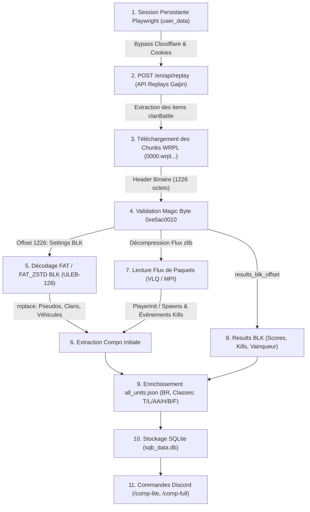

# 🦅 Anarchism Bot — Bot Discord pour Escadron War Thunder

[](https://www.python.org/)
[](https://nextcord.readthedocs.io/)
[](https://playwright.dev/)
[](https://www.gnu.org/licenses/agpl-3.0)

> **Navigation de langue / Language Navigation**  
> 🇫🇷 **Français** | 🇬🇧 [English Version (README.md)](README.md)

---

## 📌 Présentation du Projet

**Anarchism Bot** (`Test-Bot-WT`) est un bot Discord d'élite conçu pour les escadrons compétitifs sur **War Thunder (Squadron Battles / SQB)**. Développé avec la librairie **Nextcord**, il réunit des modules communautaires complets (recrutement, tickets, salons vocaux éphémères, cartes de bienvenue) et une suite d'espionnage et de tactique compétitive :

- **Radar de Compositions SQB en temps réel** : analyse et affiche les compositions d'équipe et véhicules déployés par les escadrons adverses (`/comp-lite`, `/comp-full`, `/log-squadron`).
- **Sniffer de Replays Serveur Gaijin** : surveille et interroge directement les serveurs de replays de tournois War Thunder.
- **Parseur Binaire WRPL** : décode les fichiers replays `.wrpl` (FAT BLK, flux zlib de paquets, kills, awards, scores de fin de partie).
- **Scraper du Calendrier SQB Officiel** : extrait automatiquement le calendrier des rotations de Battle Rating (BR) depuis le forum officiel War Thunder.
- **Générateur Scoreboard Glassmorphism** : produit des visuels graphiques récapitulatifs (images 940x528) façon iOS avec fond de carte et badges de véhicules.

---

## 🚀 Fonctionnalités Principales

| Module | Emplacement | Description |
| :--- | :--- | :--- |
| **Tracker de Lineups SQB** | `cogs/SquadronManager.py`, `wrpl/` | Analyse et affiche les compositions jouées sur les dernières 24h par un clan. |
| **Poller de Replays** | `wrpl/poller.py`, `views/session_wt.py` | Surveillance continue via navigateur headless Playwright de l'API Gaijin. |
| **Parseur Binaire WRPL** | `wrpl/wrpl_parser.py`, `wrpl/diag_wrpl.py` | Rétro-ingénierie des conteneurs `.wrpl`, extraction BLK FAT/FAT_ZSTD et paquets MPI. |
| **Base Véhicules Unifiée** | `wrpl/all_units.py` | Fusion des APIs `wtvehiclesapi` & `thunderinsights` pour générer `all_units.json` avec BRs et rôles. |
| **Calendrier BR Forum** | `utils/web_scraping/`, `cogs/Informations.py` | Scrape chaque mois les dates et BRs SQB depuis le forum Gaijin. |
| **Recrutement & Tickets** | `cogs/Tickets.py`, `views/applications_views.py` | Formulaires modaux, approbation staff, création de fils privés et archivage. |
| **Salons Vocaux Dynamiques** | `cogs/Vocals.py` | Hub "Rejoindre pour créer" avec suppression automatique dès que le salon est vide. |
| **Système de Bienvenue** | `cogs/Welcome.py`, `images/welcome/` | Génération dynamique d'images d'accueil personnalisées et distribution automatique de rôles. |
| **Moteur Scoreboard** | `utils/renderer_log.py` | Génération Pillow avec effet glassmorphism et alignement précis des statistiques K/D/A. |

---

## 🔬 Guide Technique Approfondi : Extraction des Compositions depuis les Serveurs Gaijin

War Thunder ne propose aucune API publique documentée pour les Squadron Battles. Cependant, l'ensemble des parties jouées est stocké sur les serveurs de replays Gaijin.

Voici le fonctionnement détaillé du pipeline d'extraction :



---

### Étape 1 : Authentification & Contournement Cloudflare (`views/session_wt.py`)

Le portail `https://warthunder.com/en/tournament/replay/` est protégé par Cloudflare (Turnstile / Bot Management) et contrôle les sessions via cookies sécurisés. Une requête HTTP directe renvoie une erreur 403.

1. **Contexte Persistant** : Playwright initialise un navigateur Chromium avec un dossier de profil dédié (`./user_data/`) :
   ```bash
   python views/session_wt.py
   ```
2. **Connexion Manuelle** : Une fenêtre Chromium visible s'ouvre. L'utilisateur se connecte avec son compte War Thunder, coche **"Se souvenir de moi"**, sélectionne le filtre **"Squadron battle"** pour valider l'affichage des replays, puis valide dans le terminal en appuyant sur `Entrée`.
3. **Persistance** : Le navigateur se ferme proprement en scellant les cookies (`cf_clearance`, `csrftoken`, `identity_token`, `identity_sid`, `session_id`) et le `User-Agent`. En arrière-plan (`poller.py`), ces identifiants sont réutilisés sans déclencher de captcha.

---

### Étape 2 : Interrogation de l'API Replays Tournois

Une fois authentifié, le client envoie une requête POST à l'API interne :

- **URL** : `POST https://warthunder.com/en/api/replay`
- **En-têtes** :
  ```http
  Content-Type: application/json
  User-Agent: <Browser User Agent>
  Referer: https://warthunder.com/en/tournament/replay/
  ```
- **Charge utile (`SQB_PAYLOAD`)** :
  ```json
  {
    "gameMode": ["arcade", "realistic", "simulation"],
    "gameType": "clanBattle",
    "techType": "all",
    "findMissionValue": "",
    "findUserValue": "",
    "findUserType": "USERNAME",
    "isUserOwnReplays": false,
    "rankRange": "",
    "timeRangeFrom": "",
    "timeRangeTo": "",
    "limit": 100,
    "page": 1
  }
  ```
- **Structure de Réponse** : Un objet JSON contenant une liste `"items"`. Chaque élément correspond à une partie d'escadron :
  - `id` : Identifiant hexadécimal de la session (ex : `"650013b0028f640"`).
  - `url` : URL racine de téléchargement du replay (ex : `"https://wt-game-replays.warthunder.com/0650013b0028f640/"`).
  - `startTime` : Timestamp de début du match.

---

### Étape 3 : Téléchargement des Segments Binaire `.wrpl`

Les replays serveur War Thunder sont découpés en plusieurs fichiers représentant chacun une tranche de temps : `0000.wrpl`, `0001.wrpl`, etc.

1. **Construction de l'URL** :
   ```
   https://wt-game-replays.warthunder.com/<session_hex>/<part:04d>.wrpl
   ```
2. **Validation Magic Bytes** :
   Chaque fichier `.wrpl` valide commence obligatoirement par les 4 octets `0xe5, 0xac, 0x00, 0x10` (`0xe5ac0010`).
3. **Détection de Fin de Partie** :
   Le téléchargement incrémente l'index (`0000`, `0001`, `0002`...). Dès que le serveur retourne un code **HTTP 404**, cela indique que le dernier segment est atteint.
4. **Gestion du Rate-Limit** :
   En cas de code **HTTP 429 Too Many Requests**, le bot respecte l'en-tête `Retry-After` et temporise (10 à 30 secondes) avec un étalement des requêtes (`DL_STAGGER_DELAY = 0.5s`) pour éviter d'être banni temporairement.

---

### Étape 4 : Rétro-ingénierie et Parsing Binaire des fichiers `.wrpl`

Le format `.wrpl` est un conteneur binaire propriétaire analysé à partir des travaux de [wrpl-inspector](https://github.com/maxsupermanhd/wrpl-inspector).

#### A. Le Header Fixe (1226 octets)
Le header est extrait avec `struct.unpack_from` :
```python
HEADER_FORMAT = "<4si128s260s128s128s32siB35sI4sQB3sIH30s128sIII48s128s128s2s"
```
Informations essentielles extraites :
- `magic` (4 octets) : doit être égal à `0xe5ac0010`.
- `results_blk_offset` (int32) : décalage en octets vers le bloc de score final.
- `session_id` (uint64) : ID unique de la session de jeu.
- `settings_blk_size` (uint32) : taille en octets du bloc Settings BLK.
- `is_server` : vérifié par l'octet `raw_unk2[1] == 0x5a` (confirme qu'il s'agit d'un replay serveur complet).

#### B. Parsing du Settings BLK (Roster des Joueurs & Compositions Initiales)
Situé directement à l'offset `1226` sur une longueur de `settings_blk_size` octets.
- **Type de BLK** :
  - `0x01` : FAT BLK standard
  - `0x02` : FAT_ZSTD (compressé avec Zstandard, utilisé sur les replays récents).
- **Décodage ULEB-128** : Utilise l'encodage ULEB128 pour lire les dictionnaires de chaînes de caractères (`names`) et la table des descripteurs de blocs.
- **Extraction de la liste `mplace`** :
  Le bloc contient la structure `mplace` (ou `player`) qui recense chaque joueur :
  - `name` : Pseudo du joueur.
  - `clanTag` : Tag de l'escadron (ex : `_VCOM_`).
  - `userId` : Identifiant joueur unique Gaijin.
  - `team` : Équipe 1 ou Équipe 2.
  - `aircraft` / `vehicle` : Identifiant technique du véhicule sélectionné (ex : `germ_leopard_2a7v`, `su_27_sm`).

#### C. Décodage du Flux de Paquets (Événements In-Game)
Situé entre `1226 + settings_blk_size` et `results_blk_offset` :
1. **Décompression** : Décompressé via `zlib.decompress(..., wbits=-15)` (DEFLATE brut) ou `wbits=15`/`47`.
2. **Décodage VLQ (Variable Length Quantity)** : La taille de chaque paquet est encodée sur 1 à 5 octets.
3. **Analyse des Paquets** :
   - `Type 4 (MPI)` : Signatures `0x0258aaff` ou `0x02582df0` (`PlayerInit`) permettant de lier dynamiquement les slots (0 à 255) aux véhicules réellement déployés en partie.
   - `Événements Kills` : Type de munition utilisée (AP, APHE, HEAT, HE), slot de l'attaquant, slot et véhicule de la victime.

#### D. Results BLK (Statistiques Finales)
Situé à `results_blk_offset` :
- Contient le vainqueur (`winTeam`), les scores totaux des joueurs, les compteurs de kills et morts, et les véhicules finaux.

---

### Étape 5 : Enrichissement des Véhicules (`wrpl/all_units.py`)

Les replays ne contiennent que les identifiants bruts (ex : `us_m1a2_sep2_abrams`). Pour restituer un affichage propre :
1. Interrogation de deux APIs complémentaires :
   - `https://wtvehiclesapi.duckdns.org/api/vehicles` (données techniques, BR Réaliste).
   - `https://api.thunderinsights.dk/v1/units/` (noms complets localisés et catégories).
2. Fusion dans le fichier `data/all_units.json` :
   - Associe chaque identifiant à son `full_name`, `country`, `vehicle_type`, `realistic_ground_br`, et chemin de l'image PNG locale (`images/vehicles/*.png`).
3. Catégorisation standardisée pour l'escadron :
   - `T` = Char lourd / moyen / Chasseur de chars
   - `L` = Char léger
   - `AA` = Véhicule antiaérien (DCA/SPAA)
   - `H` = Hélicoptère
   - `B` = Bombardier / Avion d'attaque au sol
   - `F` = Chasseur aérien

---

### Étape 6 : Normalisation et Formatage des Compositions

Lors de l'exécution de `/comp-lite tag_escadron:VCOM`, le bot interroge `sqb_data.db` :
1. **Nettoyage du Tag Clan** : Suppression des préfixes et suffixes parasites générés par Gaijin (`COOPBOT363XELYXA_` -> `XELYX`).
2. **Ratio de la Composition** : Calcul du format compact ordonné `F / B / T / A` (ex : `4T / 2AA / 1H / 1F`).
3. **Indicateur de Fraîcheur** :
   - Vert : match joué il y a moins de 60 minutes.
   - Rouge (`⚠️`) avec préfixe `- ` : match joué il y a plus d'1 heure.

---

## 💻 Répertoire des Commandes Discord

| Commande Slash | Permissions | Description |
| :--- | :--- | :--- |
| `/comp-lite <tag>` | Tout le monde | Affiche les dernières compositions (24h) de l'escadron ciblé. |
| `/comp-full <tag>` | Administrateur | Audit complet de la session (MVP, K/D global, stats joueurs, carte, victoire). |
| `/log-squadron <tag> <type>` | Administrateur | Récupère les logs, points ou classements d'un escadron. |
| `/sqb-viewer` | Administrateur | Affichage interactif des véhicules optimaux pour le BR SQB en cours. |
| `/cleanup-db` | Administrateur | Nettoyage manuel des anciennes sessions et des fichiers replays temporaires. |
| `/setup` | Administrateur | Assistant de configuration du serveur (catégories, rôles, canaux logs). |
| `!sync` | Owner Bot | Force la synchronisation des commandes slash avec l'API Discord. |

---

## 🛠️ Installation & Configuration

### Prérequis
- Python 3.10, 3.11 ou 3.12
- Navigateur Chromium via Playwright (`playwright install chromium`)
- SQLite 3

### 1. Installation des Dépendances
```bash
git clone https://github.com/YourUsername/Test-Bot-WT.git
cd Test-Bot-WT

python -m venv .venv
# Sur Windows :
.venv\Scripts\activate
# Sur Linux :
source .venv/bin/activate

pip install -r requirements.txt
playwright install chromium
```

### 2. Générer la Base de Véhicules
```bash
python wrpl/all_units.py
```

### 3. Sceller la Session Gaijin (Configuration Unique)
Pour permettre au bot de requêter les serveurs de replays sans blocage Cloudflare :
```bash
python views/session_wt.py
```
Connectez-vous à votre compte Gaijin dans la fenêtre ouverte, cochez **"Se souvenir de moi"**, filtrez sur Squadron Battles, puis appuyez sur `Entrée` dans votre terminal.

### 4. Configuration du Fichier `.env`
Créez un fichier `.env` à la racine :

```ini
# Identifiants Discord
TOKEN=votre_token_bot_discord_ici
COGS=cogs

# Identifiants Serveurs (Guilds)
GUILD_STAFF_SERVER_ID=123456789012345678
GUILD_SQB_SERVER_ID=123456789012345678
COMMUNITY_SERVER_GUILD_ID=123456789012345678

# Salons et Rôles Staff
STAFF_SERVER_TICKETS_LOG_CHANNEL_ID=123456789012345678
STAFF_SERVER_CHANNEL_ID=123456789012345678
SQB_SERVER_STAFF_ROLE_ID=123456789012345678
SQB_SERVER_STAFF_CHANNEL_ID=123456789012345678
COMMUNITY_STAFF_ROLE_ID=123456789012345678
COMMUNITY_STAFF_CHANNEL_ID=123456789012345678

# Rôles et Canaux d'Accueil
GUILD_SQB_WELCOME_CHANNEL_ID=123456789012345678
GUILD_SQB_ROLE_ID_DEFAULT=123456789012345678
GUILD_SQB_ROLE_ID_WARN=123456789012345678
GUILD_SQB_ROLE_ID_POP=123456789012345678
GUILD_SQB_ROLE_ID_GRADES=123456789012345678
GUILD_SQB_ROLE_ID_ROLES=123456789012345678
GUILD_SQB_ROLE_ID_LOCALISATION=123456789012345678

# Liens externes de recrutement (Recommandé)
STAFF_RECRUITMENT_SHEET_URL=https://docs.google.com/spreadsheets/d/...
RECRUITMENT_FORM_URL=https://docs.google.com/forms/d/...

# Chemins de Stockage
DATABASE_UNITS=data/all_units.json
DATABASE_REPLAY=data/sqb_data.db
DATABASE_REPLAYS_WRPL=data/replays
USER_DATA=user_data
DATABASE_LOGS=logs
DATABASE_IMAGES_VEHICLES=images/vehicles
```

### 5. Démarrage du Bot
```bash
python main.py
```

---

## 📂 Structure du Répertoire / Project Structure

```text
Test-Bot-WT/
├── cogs/                          # Extensions Nextcord (Commandes et tâches cycliques)
│   ├── CriticalError.py           # Gestion globale des erreurs
│   ├── Informations.py            # Planification SQB & viewer de véhicules
│   ├── Setup.py                   # Assistant de configuration interactif
│   ├── SquadronManager.py         # Intelligence SQB (/comp-lite, /comp-full, /cleanup-db)
│   ├── Tickets.py                 # Système de recrutement et support
│   ├── Vocals.py                  # Salons vocaux éphémères "Join to Create"
│   └── Welcome.py                 # Accueil dynamique et attribution de rôles
├── core/
│   └── config.py                  # Intents Discord & configuration centrale
├── database/                      # Modèles et interfaces SQLite (Tickets, SQB, Infos)
├── embed/                         # Modèles et builders d'embeds Discord
├── helpers/                       # Fonctions utilitaires (formatage durées, dates)
├── images/                        # Ressources visuelles (cartes de maps, badges, logos)
├── utils/
│   ├── buttons/                   # Boutons UI Nextcord
│   ├── inputs/                    # Modaux et champs de texte
│   ├── selects/                   # Menus déroulants UI
│   ├── threads/                   # Gestion des fils privés
│   ├── web_scraping/              # Scraper forum pour les saisons SQB
│   └── renderer_log.py            # Moteur graphique scoreboard (Pillow glassmorphism)
├── views/                         # Vues d'interface Nextcord & session_wt.py
├── wrpl/                          # Moteur de traitement des replays War Thunder
│   ├── all_units.py               # Générateur de la base all_units.json
│   ├── diag_wrpl.py               # Diagnostic et validation de structure binaire WRPL
│   ├── poller.py                  # Surveillance automatisée des replays Gaijin
│   ├── wrpl_parser.py             # Parseur binaire WRPL (Header, BLK, Paquets)
│   └── db_replay.py               # Persistance SQLite des sessions et compositions
├── CHANGELOG.md                   # Historique des versions
├── requirements.txt               # Dépendances Python
├── README.md                      # Documentation en anglais
└── README_FR.md                   # Documentation en français (ce fichier)
```

---

## 📜 Auteurs & Remerciements

- **Auteur** : Chicken-Fried
- **Remerciements particuliers** : 
  - [wrpl-inspector](https://github.com/maxsupermanhd/wrpl-inspector) pour la documentation initiale des paquets et spécifications BLK `.wrpl`.
  - [wtvehiclesapi](https://wtvehiclesapi.duckdns.org/) & [ThunderInsights](https://api.thunderinsights.dk/) pour leurs bases de données ouvertes sur les véhicules War Thunder.
